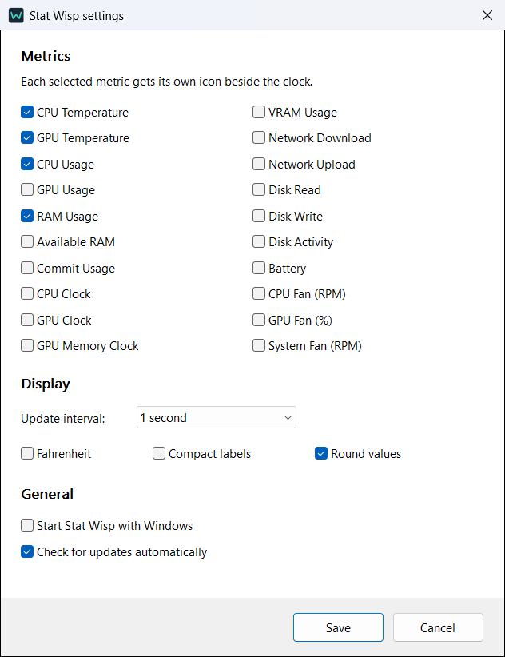

# Stat Wisp

Your PC's vitals, quietly in the Windows tray.

Stat Wisp is a tiny native Windows monitor that shows the readings you choose (temperatures, usage, memory, clocks, network, disk, battery, fans) as small icons beside the clock. Hover for details; right-click for settings.

**[Download the latest release](https://github.com/grayfvll01/stat-wisp/releases/latest)** · [User guide](docs/user-guide.md) · [Deployment](docs/deployment.md) · [Report a problem](https://github.com/grayfvll01/stat-wisp/issues/new/choose)



## Install

Windows 10 or 11, x64. No administrator rights or runtimes needed.

| Download | Use it for |
|---|---|
| `stat-wisp-<version>-setup.exe` | Install for your account, with Start menu and uninstall entries. |
| `stat-wisp-<version>-win-x64.zip` | Portable: extract anywhere and run `stat-wisp.exe`. |
| `SHA256SUMS.txt` | [Verify your download](docs/user-guide.md#verify-a-download). |

Release files are unsigned, so Windows may show an unknown-publisher warning.

## Updates

Stat Wisp checks GitHub for a new release once a day and shows a notification when one is available. One click downloads it, verifies its SHA-256 checksum, and installs it. Turn this off in **Settings**, or centrally with a [policy](docs/deployment.md#disable-updates).

## Privacy

No telemetry, accounts, or tracking. The only network request is the update check to GitHub. Sensor readings stay on your PC.

## Sensors

CPU temperature and CPU/system fans need a running [LibreHardwareMonitor](https://github.com/LibreHardwareMonitor/LibreHardwareMonitor) or OpenHardwareMonitor with WMI enabled. GPU readings depend on the NVIDIA or AMD driver. `--` means unavailable. See the [support matrix](docs/sensor-support.md).

## Build

Visual Studio 2022 or later with C++ tools, and Inno Setup 6 for the installer:

```powershell
./scripts/build-release.ps1          # build, test, and package into dist/
./scripts/build-release.ps1 -ExeOnly # executable only
```

See [development](docs/development.md) and [contributing](CONTRIBUTING.md).

## License

[MIT](LICENSE)
